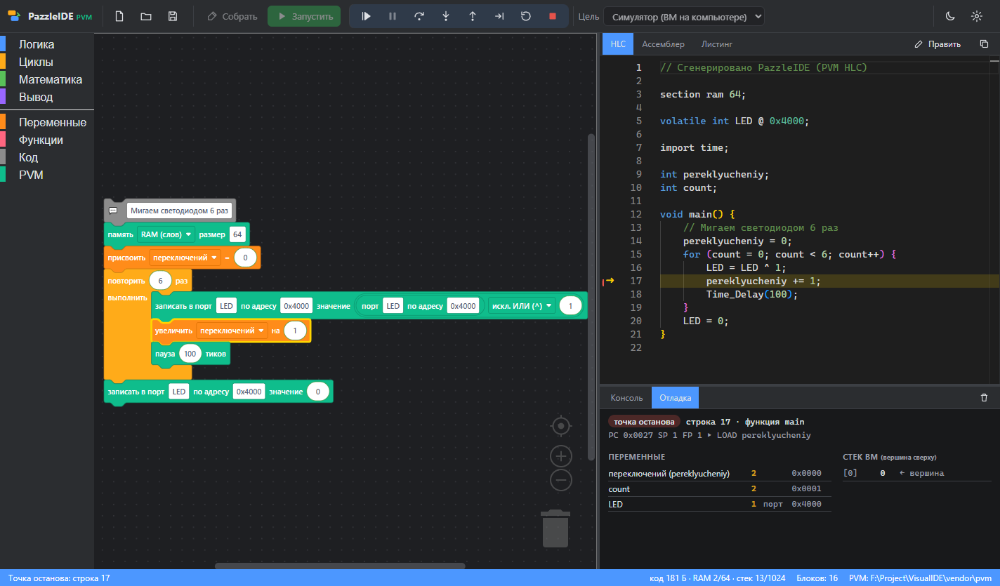

# PazzleIDE для PVM

IDE для визуального программирования виртуальной машины [PVM](../pvm) (Pico Virtual Machine — стековая ВМ
для микроконтроллеров). Программа собирается из блоков, как в Scratch, и сразу превращается в код
**PVM HLC**. Дальше её можно собрать, выполнить и пошагово отлаживать в симуляторе или на плате по
последовательному порту.



## Возможности

* **Блоки в стиле Scratch** (Blockly, рендерер `zelos`): логика, циклы, целочисленная математика, функции,
  переменные, а также категория **PVM** — порты периферии (`volatile int LED @ 0x4000`), вызовы `svc`,
  побитовые операции, системный тик и пауза (`lib/time.hlc`), размеры памяти (`section`), `halt`.
* **Код HLC обновляется сразу**, его можно переключить в ручное редактирование. После сборки рядом видны
  **ассемблер** (`pvmcc`) и **листинг** с адресами и картой памяти (`pvmc -l`).
* **Сборка** (Ctrl+B): `bin`, `hex`, C-массив, листинг и карта отладки. Ошибки компиляции показываются
  прямо на блоках.
* **Запуск** (Ctrl+F5) в симуляторе `pvmsim` или на плате (программа с хоста, без прошивки).
* **Отладка** (F5) в симуляторе, на плате с программой с хоста или с прошитой программой:
  * точки останова на блоках и строках HLC;
  * подсветка текущего блока;
  * шаги с обходом, с заходом и с выходом из функции, а также шаг на одну инструкцию ВМ;
  * пауза;
  * переменные с именами из блоков и значения портов;
  * стек ВМ.
* **Экспорт проекта** для `make` и VS Code через `pvminit`.
* **Командная строка**: код HLC, сборка и запуск без интерфейса.
* Windows, macOS и Linux (Electron); установщики собираются через electron-builder.

Подробно о сборке, целях и отладке — в [docs/DEBUGGING.md](docs/DEBUGGING.md).

## Быстрый старт

**Готовая сборка** (`release/PazzleIDE-Setup-*.exe` или `PazzleIDE-Portable-*.exe`) уже содержит утилиты PVM
(`pvmcc`, `pvmc`, `pvmsim`, `pvmdbg`, `pvmdisasm`, `pvminit` и `lib/`): ставить отдельно ничего не нужно.

Для разработки нужны [Node.js](https://nodejs.org) 20+, а для сборки утилит из исходников ещё CMake и MinGW-w64.

```bash
npm install
npm start
```

Утилиты ищутся автоматически: настройки (**Файл → Настройки → Утилиты PVM**), переменная `PVM_HOME`,
встроенные в дистрибутив, `../pvm/Release` рядом с PazzleIDE, `vendor/pvm`, `PATH`.

Плата по умолчанию — **COM3, 9600 бод**. В ней должна работать прошивка с агентом отладки PVM
(`pvm/pvmdbg.c`). Для цели «Плата: программа с хоста» ничего прошивать не нужно.

| Команда | Назначение |
|---------|------------|
| `npm start` | собрать интерфейс и запустить IDE |
| `npm run dev` | пересборка интерфейса при изменениях (в другом терминале — `node scripts/start.mjs`, затем Ctrl+R в окне) |
| `npm test` | тесты; с утилитами PVM — сборка и отладка примеров в симуляторе, с `PVM_BOARD_PORT=COM3` — и на плате |
| `npm run pvm:bundle` | собрать утилиты PVM из исходников (`../pvm` или `--src`) в `vendor/pvm` — они войдут в дистрибутив |
| `npm run dist:win` / `dist:mac` / `dist:linux` | установщики в `release/` (сначала `pvm:bundle`) |
| `npm run make-examples` | пересоздать примеры в `examples/` |

## Командная строка

```bash
node src/cli/pazzle.mjs hlc   examples/02-faktorial.pzl            # код HLC
node src/cli/pazzle.mjs build examples/02-faktorial.pzl -o out     # полная сборка в папку out
node src/cli/pazzle.mjs run   examples/04-begushchiy-ogon.pzl      # симулятор
node src/cli/pazzle.mjs run   examples/01-migalka.pzl --port COM3  # плата, программа с хоста
```

## Горячие клавиши

| Клавиши | Действие |
|---------|----------|
| Ctrl+B | собрать |
| Ctrl+F5 | запустить без отладки |
| F5 / F6 | отладка или продолжить / пауза |
| F10 / F11 / Shift+F11 | шаг с обходом / с заходом / с выходом |
| Ctrl+F11 | одна инструкция ВМ |
| Shift+F5 | остановить |
| F9 | точка останова на блоке |
| Ctrl+S, Ctrl+O, Ctrl+N | сохранить, открыть, новый проект |

## Документация

* [Сборка, запуск и отладка](docs/DEBUGGING.md): цели, плата, ограничения.
* [Описание языка (languages/pvm.json)](docs/CUSTOM_LANGUAGES.md): как блоки переводятся в HLC и как
  добавлять блоки.
* [Архитектура](docs/ARCHITECTURE.md).

## Ограничения

* В HLC только 16-битные целые: блоков для строк, ввода и списков в палитре нет.
* Печать `svc(1, x)` работает один раз подряд из-за особенности обработчика печати в PVM — см.
  [docs/DEBUGGING.md](docs/DEBUGGING.md#известное-ограничение-pvm-печать-svc1-x).
* Переменные из блоков глобальные, как в Scratch; локальные значения функций видны в стеке ВМ.

## Лицензии компонентов

Blockly — Apache 2.0, Monaco Editor — MIT, Electron — MIT. Утилиты PVM — проект PVM.
Лицензия самого проекта пока не выбрана (`UNLICENSED` в `package.json`).
