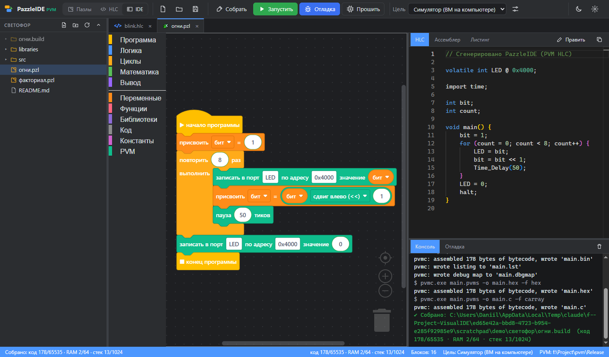

# PazzleIDE для PVM

IDE для визуального программирования виртуальной машины [PVM](../pvm) (Pico Virtual Machine — стековая ВМ
для микроконтроллеров). Программа собирается из блоков, как в Scratch, и сразу превращается в код
**PVM HLC** — или пишется на HLC сразу. Дальше её можно собрать, прошить, выполнить и пошагово отлаживать
в симуляторе или на плате по последовательному порту или по сети.


## Возможности

* **Три рабочих стола** (переключатель слева на панели, Ctrl+1/2/3):
  * **Пазлы** — блоки, код HLC рядом и панель отладки;
  * **HLC** — только код: редактор, сборка, точки останова на строках, отладка;
  * **IDE** — дерево открытой папки и вкладки: проекты пазлов, файлы HLC и любые текстовые файлы вместе;
    создание, переименование и удаление файлов из дерева, открытые вкладки переживают перезапуск.

  

* **Блоки в стиле Scratch** (Blockly, рендерер `zelos`): логика, циклы, целочисленная математика, функции,
  переменные, а также категория **PVM** — порты периферии (`volatile int LED @ 0x4000`), вызовы `svc`,
  побитовые операции, системный тик и пауза (`lib/time.hlc`), размеры памяти (`section`), `halt`.
  У блоков `svc` любое число аргументов (0–8): кнопки «−» и «+» прямо на блоке.
* **Блок «▶ начало программы»** (категория «Программа»), как «когда щёлкнут по флажку» в Scratch: то, что
  под ним, становится телом `main`. Стопки, не присоединённые к нему, не выполняются и помечаются;
  объявления (константы, память, функции) работают где угодно. Проекты без него выполняют все стопки,
  как раньше.
* **Блок «■ конец программы»** завершает программу (`halt;`), ниже него ничего не присоединить. Новый проект
  начинается с пары «начало — конец», как блок-схема; при завершении подсвечивается блок конца.
* **Локальные переменные функций**: блок «локальная переменная [x] = …» (категория «Переменные») внутри
  функции делает `x` локальной — у каждого вызова, в том числе в рекурсии, своя копия. Объявления
  поднимаются в начало тела функции, как требует HLC; переменная, которая нужна только функциям, глобальной
  не объявляется. Счётчики циклов «повторить N раз» внутри функций тоже локальные.
* **Константы** (`const int`): блок объявления и блоки значения в отдельной категории палитры. Значение
  вычисляет компилятор (числа, арифметика, биты, другие константы), в RAM константы не попадают.
  Переименование объявления переименовывает и все места использования.
* **Свои библиотеки из пазлов**: правый щелчок по функции, константе или стопке → «Сохранить в
  библиотеку…» (или **Библиотеки → Создать из проекта**). Вызываемые функции и используемые константы
  сохраняются вместе с ней. Библиотеки видны в категории палитры «Библиотеки»: перетащите блок в проект —
  нужные определения добавятся сами. Файлы `*.pzlib` лежат в папке библиотек пользователя и в папке
  `libraries` открытой в IDE папки, ими можно обмениваться.
* **Код HLC обновляется сразу**, его можно переключить в ручное редактирование. После сборки рядом видны
  **ассемблер** (`pvmcc`) и **листинг** с адресами и картой памяти (`pvmc -l`).
* **Сборка** (Ctrl+B): `bin`, `hex`, C-массив, листинг и карта отладки. Ошибки компиляции показываются
  прямо на блоках.
* **Цели** (Сборка → Цели…) — свои конфигурации: симулятор, плата по последовательному порту или **по TCP**,
  **утилита-мост**, которая запускается перед подключением, **ограничения памяти** (код, RAM, стек: что не
  помещается, не собирается), команды **прошивки** и **запуска**, переменные окружения. В командах —
  переменные IDE `${projectDir}`, `${hex}`, `${port}`… (они же в окружении как `PAZZLE_*`).
* **Прошивка** (Ctrl+U): сборка и команда прошивки текущей цели.
* **Запуск** (Ctrl+F5) в симуляторе `pvmsim` или на плате (программа с хоста, без прошивки) — или своя
  команда цели.
* **Отладка** (F5) в симуляторе, на плате с программой с хоста или с прошитой программой (по порту или TCP):
  * точки останова на блоках и строках HLC, в том числе в своих файлах `.hlc`;
  * подсветка текущего блока;
  * шаги с обходом, с заходом и с выходом из функции, а также шаг на одну инструкцию ВМ;
  * пауза;
  * стек вызовов (рекурсия целиком) с аргументами каждой функции; выбор кадра показывает место вызова на блоках;
  * параметры и локальные переменные функции, глобальные переменные с именами из блоков, порты;
  * стек ВМ.
* **Экспорт проекта** для `make` и VS Code через `pvminit`.
* **Командная строка**: код HLC, сборка и запуск без интерфейса.
* Windows, macOS и Linux (Electron); установщики собираются через electron-builder.

Подробно о сборке, целях, прошивке и отладке — в [docs/DEBUGGING.md](docs/DEBUGGING.md).

## Быстрый старт

**Готовая сборка** (`release/PazzleIDE-Setup-*.exe` или `PazzleIDE-Portable-*.exe`) уже содержит утилиты PVM
(`pvmcc`, `pvmc`, `pvmsim`, `pvmdbg`, `pvmdisasm`, `pvminit`, `pvmboard` и `lib/`): ставить отдельно ничего не нужно.

Для разработки нужны [Node.js](https://nodejs.org) 20+, а для сборки утилит из исходников ещё CMake и MinGW-w64.

```bash
npm install
npm start
```

Утилиты ищутся автоматически: настройки (**Файл → Настройки → Утилиты PVM**), переменная `PVM_HOME`,
встроенные в дистрибутив, `../pvm/Release` рядом с PazzleIDE, `vendor/pvm`, `PATH`.

Плата по умолчанию — **COM3, 9600 бод** (меняется в целях). В ней должна работать прошивка с агентом
отладки PVM (`pvm/pvmdbg.c`). Для цели «Плата: программа с хоста» ничего прошивать не нужно.

| Команда | Назначение |
|---------|------------|
| `npm start` | собрать интерфейс и запустить IDE |
| `npm run dev` | пересборка интерфейса при изменениях (в другом терминале — `node scripts/start.mjs`, затем Ctrl+R в окне) |
| `npm test` | тесты; с утилитами PVM — сборка и отладка примеров в симуляторе, с `PVM_BOARD_PORT=COM3` — и на плате |
| `npm run pvm:bundle` | собрать утилиты PVM из исходников (`../pvm` или `--src`) в `vendor/pvm` — они войдут в дистрибутив |
| `npm run dist:win` / `dist:mac` / `dist:linux` | установщики в `release/` (сначала `pvm:bundle`) |
| `npm run make-examples` | пересоздать примеры в `examples/` |

## Командная строка

```bash
node src/cli/pazzle.mjs hlc   examples/02-faktorial.pzl            # код HLC
node src/cli/pazzle.mjs build examples/02-faktorial.pzl -o out     # полная сборка в папку out
node src/cli/pazzle.mjs run   examples/04-begushchiy-ogon.pzl      # симулятор
node src/cli/pazzle.mjs run   examples/01-migalka.pzl --port COM3  # плата, программа с хоста
node src/cli/pazzle.mjs run   examples/01-migalka.pzl --tcp 192.168.1.20:5555   # плата по сети
node src/cli/pazzle.mjs build examples/03-prostye-chisla.pzl --ram 16 --stack 64   # с ограничениями памяти
```

## Горячие клавиши

| Клавиши | Действие |
|---------|----------|
| Ctrl+B | собрать |
| Ctrl+F5 | запустить без отладки |
| Ctrl+U | прошить / загрузить (команда цели) |
| F5 / F6 | отладка или продолжить / пауза |
| F10 / F11 / Shift+F11 | шаг с обходом / с заходом / с выходом |
| Ctrl+F11 | одна инструкция ВМ |
| Shift+F5 | остановить |
| F9 | точка останова на блоке |
| Ctrl+S, Ctrl+O, Ctrl+N | сохранить, открыть, новый проект пазлов |
| Ctrl+Alt+N | новый файл HLC |
| Ctrl+1 / Ctrl+2 / Ctrl+3 | рабочий стол «Пазлы» / «HLC» / «IDE» |
| Ctrl+Alt+O | открыть папку (рабочий стол «IDE») |
| Ctrl+W, Ctrl+Tab | закрыть вкладку, следующая вкладка («IDE») |

## Документация

* [Сборка, запуск, прошивка и отладка](docs/DEBUGGING.md): цели, TCP и мосты, ограничения памяти, переменные команд.
* [Описание языка (languages/pvm.json)](docs/CUSTOM_LANGUAGES.md): как блоки переводятся в HLC и как
  добавлять блоки.
* [Архитектура](docs/ARCHITECTURE.md).

## Ограничения

* В HLC только 16-битные целые: блоков для строк, ввода и списков в палитре нет.
* На Windows `pvmcc` не открывает файлы по путям с не-латинскими буквами, поэтому `import` соседнего файла
  `.hlc` работает только в папках с латинскими именами (сборка без `import` работает в любой папке).
* «Напечатать» пишет число в регистр вывода `OUT @ 0x4007` (печать через SVC в PVM убрана): в симуляторе
  это строки вывода, при отладке — значение `OUT` в панели переменных.
* Переменные из блоков глобальные, как в Scratch, пока их не сделать локальными в функции блоком
  «локальная переменная». Локальные бывают только у функций (в `main` они не нужны).

## Лицензии компонентов

Blockly — Apache 2.0, Monaco Editor — MIT, Electron — MIT. Утилиты PVM — проект PVM.
PazzleIDE распространяется по лицензии MIT (см. [LICENSE](LICENSE)).
